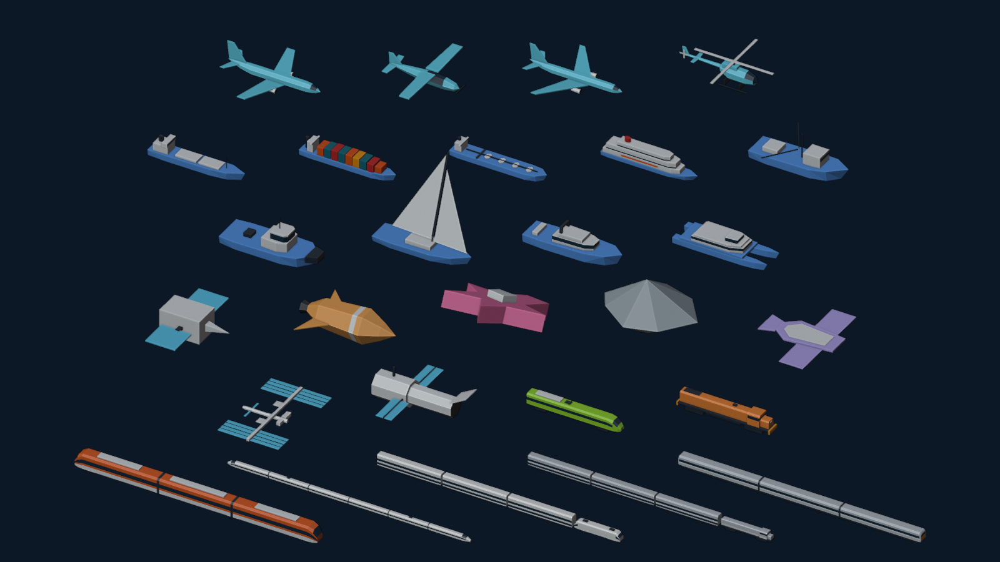

# Traffic models (`traffic-models-v1`)

`traffic-models-v1.glb` contains the low-poly 3D aircraft, vessel, train and
orbital models drawn by the map's `traffic-models-3d` layer
([#682](https://github.com/vasilyevstan/LiveTrafficStan/issues/682)). It is
repository-original work generated by
[`scripts/blender/build-traffic-models.py`](../../../scripts/blender/build-traffic-models.py)
and distributed with the source code under Apache-2.0. No third-party model,
texture, scan or marketplace asset is used.



## Regenerate

Do not edit the GLB by hand. Change the script, then run it headlessly from
the repository root. It builds a fresh factory scene and never opens, saves
or reverts a `.blend` file:

```sh
/Applications/Blender.app/Contents/MacOS/Blender -b --factory-startup --python-exit-code 1 \
  --python-expr "import runpy; runpy.run_path('$PWD/scripts/blender/build-traffic-models.py', run_name='__main__', init_globals={'GLB_PATH': '$PWD/src/assets/models/traffic-models-v1.glb', 'PNG_PATH': '$PWD/docs/images/traffic-models-v1.png'})"
```

With Blender 5.2.3, regeneration reproduces the committed GLB byte for byte
(SHA-256 `d11c2039159e9273c9839353e21a8ba0719a789783365a9c217c5675f746fabe`,
118,720 bytes). The preview PNG is illustrative only and is not byte-stable.
The script also runs in a live Blender MCP session in safe mode. There it
builds the temporary scene `LTS_TrafficModels_TMP` and exports nothing.

After regenerating, run `npx vitest run src/map/models` and `npm run build`.
The build enforces the asset budget.

## Models

Model IDs reuse the flat marker image IDs. Each model therefore follows the
same provider-reported aircraft or vessel class, or the same exact SATCAT
object type, as its flat icon. Starlink payloads use
`orbital-starlink-spacecraft`. The two featured spacecraft, the ISS and the
Hubble Space Telescope, use their own `orbital-iss` and `orbital-hubble`
models. They are chosen only after the exact reviewed identity match that
already labels them on the map; any other payload keeps `orbital-payload`.
Five trainsets represent fleets that a source identifies: `train-flirt`
(Elron Stadler FLIRT), `train-pendolino` (VR Sm3 Pendolino),
`train-intercity` (VR InterCity double-deck), `train-us-push-pull` (MBTA and
LIRR locomotive-hauled coaches) and `train-us-emu` (LIRR M7/M9). Selection
uses only the source, Fintraffic train type or an exact LIRR roster car
number. Every other train uses `train-freight` for the freight category or
`train` otherwise. All are original geometry with no logo or wordmark; the
runtime tints trainsets in original operator-coloured liveries.

| Model ID | Triangles | Nominal length × beam × height (m) |
| --- | ---: | --- |
| `aircraft` | 196 | 37.4 × 35 × 11.07 |
| `aircraft-light` | 132 | 8.5 × 11 × 2.26 |
| `aircraft-heavy` | 212 | 70 × 64 × 18.87 |
| `helicopter` | 248 | 12.45 × 10.5 × 3.2 |
| `vessel` | 132 | 60 × 11 × 12.5 |
| `vessel-cargo` | 204 | 200 × 32 × 36 |
| `vessel-tanker` | 200 | 230 × 42 × 41 |
| `vessel-passenger` | 184 | 180 × 30 × 43 |
| `vessel-fishing` | 112 | 25 × 17 × 9 |
| `vessel-tug` | 136 | 30.3 × 11 × 11.5 |
| `vessel-sailing` | 80 | 15 × 7.08 × 14.19 |
| `vessel-pleasure` | 124 | 18 × 5.2 × 4.8 |
| `vessel-highspeed` | 148 | 40 × 12.2 × 7.8 |
| `orbital-payload` | 54 | 7.6 × 11.2 × 2.8 |
| `orbital-rocket-body` | 106 | 11.4 × 8.8 × 3.46 |
| `orbital-debris` | 52 | 2.6 × 2.63 × 1.54 |
| `orbital-unknown` | 16 | 5.3 × 4.4 × 3.2 |
| `orbital-starlink-spacecraft` | 64 | 15.18 × 19.14 × 0.5 |
| `orbital-iss` | 380 | 72.6 × 109 × 7.6 |
| `orbital-hubble` | 140 | 15.2 × 14.8 × 7.2 |
| `train` | 204 | 25.55 × 3 × 4.25 |
| `train-freight` | 192 | 21.5 × 3.1 × 4.25 |
| `train-flirt` | 320 | 58.6 × 3.2 × 4.3 |
| `train-pendolino` | 416 | 158.9 × 3.2 × 4 |
| `train-intercity` | 392 | 100.65 × 3.2 × 5.1 |
| `train-us-push-pull` | 348 | 101.35 × 3.2 × 4.8 |
| `train-us-emu` | 224 | 77.75 × 3.2 × 3.8 |

The set has 5,016 triangles in total. Apart from the ISS, Hubble and the
fleet trainsets, the models are symbolic class shapes, not specific
airframes, hulls, rolling stock or spacecraft. The two named spacecraft are
simplified recognisable outlines, not engineering models, and each may use
up to 400 triangles because at most one of each is drawn. Fleet trainsets
are simplified multi-car consists of their class, not a specific unit, and
may use up to 450 triangles. A vessel with a valid reported length between 2 and
500 m is scaled to that length. Every model is drawn at least as large as its
flat icon. While that screen-size floor enlarges a long hull or train, the
model is widened and shortened by the same factor (area preserved) so its
painted length-to-beam ratio is at most 3.5 for vessels and 4 for trains; it
returns to true proportions as soon as the floor no longer enlarges it. A
train gets a model only when it has a finite reported or derived course; a
train without a course stays a flat dot.

## Conventions

- **Units and frame:** metres, with r = starboard, f = forward (nose or bow)
  and u = up. Each model is centred on its footprint and rests on u = 0. The
  default glTF export therefore yields +Z forward, +Y up and −X starboard.
- **One node per model:** each node is named `LTS_<model id>`. Its `extras`
  carry `lts_model_set`, `lts_model_id`, `lts_kind` and the nominal
  `lts_length_m`, `lts_beam_m` and `lts_height_m`.
- **Colour roles:** each material sets `extras.lts_role`:
  - `body` faces are tinted per class and theme from the flat-icon palettes,
    including aircraft altitude bands;
  - `detail` faces use the theme's neutral detail colour, except that fleet
    trainsets use their livery stripe colour;
  - `accent` faces keep their exported colour.

`src/map/models/trafficModelAsset.ts` rejects the whole asset, leaving the
flat icons in place, if any of these limits fail:

- GLB version 2;
- at most 128 KiB;
- only the expected top-level and node keys;
- float32 positions, unsigned-short indices and triangles only;
- coordinates within 1,000 m;
- at most 600 triangles per model;
- exactly the IDs in `trafficModelCatalog.ts`.

Adding or renaming a model, changing the vertex layout or changing a colour
role needs matching changes in those two modules and their tests.
