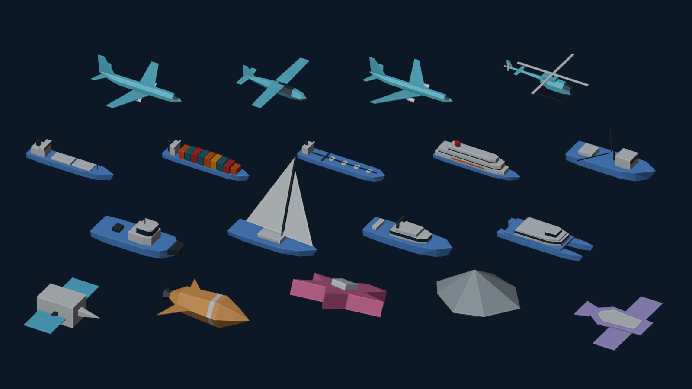

# Traffic models (`traffic-models-v1`)

`traffic-models-v1.glb` contains the low-poly 3D aircraft, vessel and orbital
models drawn by the map's `traffic-models-3d` layer
([#682](https://github.com/vasilyevstan/LiveTrafficStan/issues/682)). It is
repository-original work generated by
[`scripts/blender/build-traffic-models.py`](../../../scripts/blender/build-traffic-models.py)
and distributed with the source code under Apache-2.0. No third-party model,
texture, scan or marketplace asset is used.



## Regenerate

Do not edit the GLB by hand. Change the script, then run it headlessly from
the repository root. It builds a fresh factory scene and never opens, saves
or reverts a `.blend` file:

```sh
/Applications/Blender.app/Contents/MacOS/Blender -b --factory-startup --python-exit-code 1 \
  --python-expr "import runpy; runpy.run_path('$PWD/scripts/blender/build-traffic-models.py', run_name='__main__', init_globals={'GLB_PATH': '$PWD/src/assets/models/traffic-models-v1.glb', 'PNG_PATH': '$PWD/docs/images/traffic-models-v1.png'})"
```

With Blender 5.2.3, regeneration reproduces the committed GLB byte for byte
(SHA-256 `d2715d39fa44799a0260e9b065487abdd6d7156e77c3a7198729fcc5cbdbb84a`,
60,680 bytes). The preview PNG is illustrative only and is not byte-stable.
The script also runs in a live Blender MCP session in safe mode. There it
builds the temporary scene `LTS_TrafficModels_TMP` and exports nothing.

After regenerating, run `npx vitest run src/map/models` and `npm run build`.
The build enforces the asset budget.

## Models

Model IDs reuse the flat marker image IDs. Each model therefore follows the
same provider-reported aircraft or vessel class, or the same exact SATCAT
object type, as its flat icon. Starlink payloads use
`orbital-starlink-spacecraft`.

| Model ID | Triangles | Nominal length × beam × height (m) |
| --- | ---: | --- |
| `aircraft` | 196 | 37.4 × 35 × 11.07 |
| `aircraft-light` | 132 | 8.5 × 11 × 2.26 |
| `aircraft-heavy` | 212 | 70 × 64 × 18.87 |
| `helicopter` | 248 | 12.45 × 10.5 × 3.2 |
| `vessel` | 132 | 60 × 11 × 12.5 |
| `vessel-cargo` | 204 | 200 × 32 × 36 |
| `vessel-tanker` | 200 | 230 × 42 × 41 |
| `vessel-passenger` | 184 | 180 × 30 × 43 |
| `vessel-fishing` | 112 | 25 × 17 × 9 |
| `vessel-tug` | 136 | 30.3 × 11 × 11.5 |
| `vessel-sailing` | 80 | 15 × 7.08 × 14.19 |
| `vessel-pleasure` | 124 | 18 × 5.2 × 4.8 |
| `vessel-highspeed` | 148 | 40 × 12.2 × 7.8 |
| `orbital-payload` | 54 | 7.6 × 11.2 × 2.8 |
| `orbital-rocket-body` | 106 | 11.4 × 8.8 × 3.46 |
| `orbital-debris` | 52 | 2.6 × 2.63 × 1.54 |
| `orbital-unknown` | 16 | 5.3 × 4.4 × 3.2 |
| `orbital-starlink-spacecraft` | 64 | 15.18 × 19.14 × 0.5 |

The set has 2,400 triangles in total. The models are symbolic class shapes,
not specific airframes, hulls or spacecraft. A vessel with a valid reported
length between 2 and 500 m is scaled to that length. Every model is drawn at
least as large as its flat icon.

## Conventions

- **Units and frame:** metres, with r = starboard, f = forward (nose or bow)
  and u = up. Each model is centred on its footprint and rests on u = 0. The
  default glTF export therefore yields +Z forward, +Y up and −X starboard.
- **One node per model:** each node is named `LTS_<model id>`. Its `extras`
  carry `lts_model_set`, `lts_model_id`, `lts_kind` and the nominal
  `lts_length_m`, `lts_beam_m` and `lts_height_m`.
- **Colour roles:** each material sets `extras.lts_role`:
  - `body` faces are tinted per class and theme from the flat-icon palettes,
    including aircraft altitude bands;
  - `detail` faces use the theme's neutral detail colour;
  - `accent` faces keep their exported colour.

`src/map/models/trafficModelAsset.ts` rejects the whole asset, leaving the
flat icons in place, if any of these limits fail:

- GLB version 2;
- at most 128 KiB;
- only the expected top-level and node keys;
- float32 positions, unsigned-short indices and triangles only;
- coordinates within 1,000 m;
- at most 600 triangles per model;
- exactly the IDs in `trafficModelCatalog.ts`.

Adding or renaming a model, changing the vertex layout or changing a colour
role needs matching changes in those two modules and their tests.
